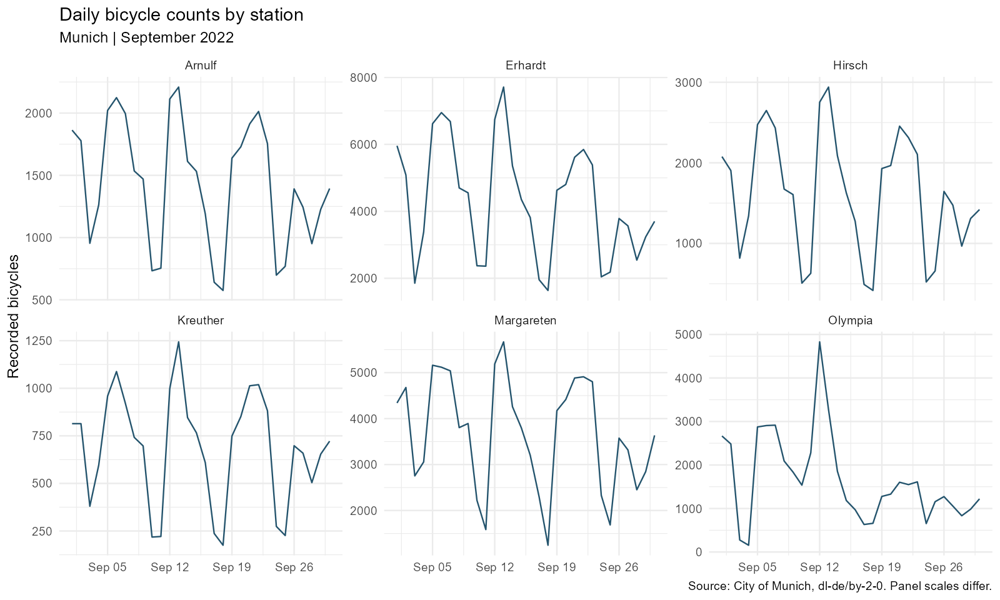
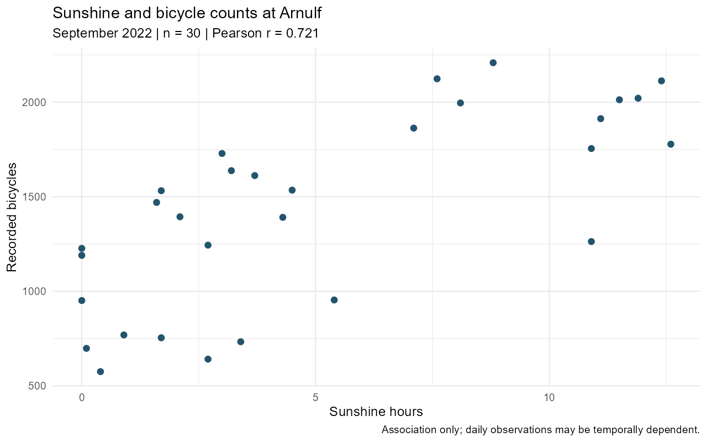
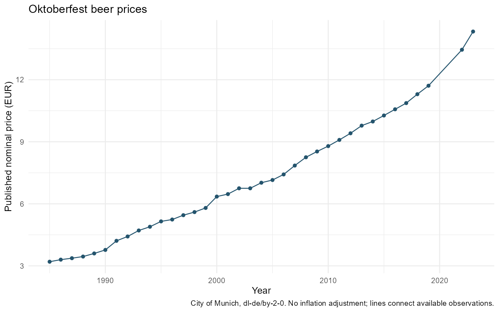

# Results

Daily cycling counts, weather and beer prices from Munich open data.

- Cycling data: 180 station-day rows across 6 stations (2022-09-01 to 2022-09-30).
- Direction-count inconsistencies: 0. They are reported, not silently corrected.
- Arnulf sunshine association: Pearson r = 0.721 (n = 30).
- Exploratory two-sided permutation p = 0.0001, using 9,999 permutations and a +1 correction.
- Beer prices: 37 observations; EUR 3.20 (1985) to EUR 14.33 (2023), a nominal increase of 347.8%.

## Reading the results

The sunshine correlation describes 30 days at Arnulf. Weekday patterns and serial dependence also affect daily traffic; the permutation test assumes exchangeable observations.
The station totals measure bicycle passages in September 2022. Zero counts and missing values are retained in the quality checks.
Price changes compare consecutive available observations. Prices are reported in nominal euros, and gaps in the series are retained.

## Figures

